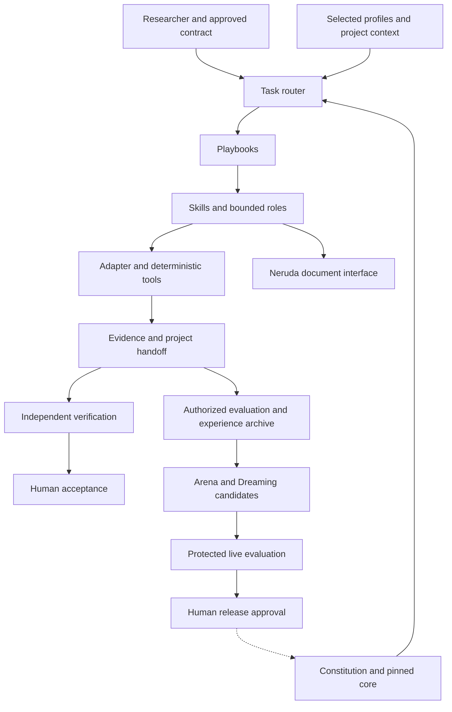
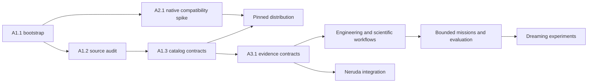

# ANDES architecture

**Status:** approved conceptual boundaries with accepted A1 foundation and A2.1 evidence at reviewed main `0f28ee50709354b255e39b325a37b8ce33ccc219`. Reference [ADR-001](docs/decisions/ADR-001.md), accepted [ADR-004](docs/decisions/ADR-004.md), [design baseline](docs/design-baseline.md) and [closeout](docs/evidence/foundation-closeout.md). The repository has executable foundation tooling and a temporary candidate adapter; it has no production installer or released runtime.

## System boundary

This diagram maps the target responsibilities. The status table below distinguishes the implemented foundation from planned capabilities; arrows do not imply that later services or integrations exist.

ANDES owns workflow definitions and explicit contracts, not the user's research code, data, external accounts or native chat history. Codex is the first runtime adapter. Neruda owns standalone typesetting and document infrastructure. GitHub is the initial source and task coordination system; source revisions and observed execution remain authoritative for actual behavior. ECx and other upstreams are reference sources only until specific reuse is reviewed. AEGIS informs public scientific values without requiring a persona or copying private context.

## Component responsibilities and interfaces

| Boundary | Responsibility | Current status / evidence |
|---|---|---|
| Constitution | Mandatory norms, proportional rigour and human authority | Accepted policy; [CONSTITUTION.md](CONSTITUTION.md). |
| Principles and skills | Focused procedures with clear triggers/outputs | Four original core skills implemented; no broad scientific/domain library yet. |
| Playbooks and roles | Compose skills and bounded responsibilities | Routing pointers implemented. General role execution/topologies remain unverified/planned. |
| Profiles/catalog | Canonical IDs, local dependency/composition and provenance eligibility | Accepted [v1 contract](docs/catalog-contract.md), semantic validator, core catalog and fixtures; production domain profiles/release resolution absent. |
| Task router | Progressive selection and explicit invocation | One independent agent selection/task fixture plus native explicit input assembly; [bounded evidence](docs/core-fixture.md), not native implicit-routing verification. |
| Distribution and adapter | Native projection and eventual pinned distribution | Temporary project-local candidate implemented under ADR-004; installer, ownership-aware update/rollback and release resolver remain planned. |
| Context and evidence | Orientation, verification and resumable handoff | Skills and dated receipts implemented; A3.1 durable task/evidence wire schemas remain planned. |
| Scientific profiles | Numerical, ML, biological and HPC methods | Planned; domain tests, source permissions and approval still required. |
| Mission runtime | Enforced scope, budgets, recovery and cancellation | Planned/disabled pending G5 evidence; no autonomy runtime implemented. |
| Evaluation and Dreaming | Protected comparisons, replay and human promotion | Planned/disabled pending G6/G7; synthetic foundation fixtures are not a protected evaluator. |
| Neruda integration | Independently versioned document interface | Planned interoperability; no runtime coupling or implemented interface claimed. |

There is no production frontend/back-end service split. The user interface is the native agent, CLI/adapter if proven necessary, repository files and GitHub. Canonical workflow definitions must remain independent of runtime-specific configuration. Keep deterministic checks separate from language-model judgment and enforcement. Do not implement a central state service or database without measured need and an ADR.

## Data and authority model

`Component` and `Profile` have the accepted local catalog contract. Other logical entities—`Release`, `ProjectContext`, `TaskContract`, `EvidenceReceipt`, `Handoff`, `DecisionRecord`, `Mission`, `Attempt`, `EvaluationProtocol`, `Candidate`, `ExperienceNode` and `ObservedTransition`—remain design concepts rather than finalized wire schemas. Each durable identity must link to immutable source/revision and ownership. A3.1 and later tasks establish their fields, migrations, persistence and validation. An ANDES release lockfile, `andes.yaml` and `.andes/` remain proposals; the existing `uv.lock` pins Python verification dependencies, not an ANDES release.

| Record | Authoritative owner |
|---|---|
| Approved design, requirements and ADR | Designated human maintainer / project lead |
| Runtime code and observed behavior | Exact code revision and executed artifacts |
| Task status, dependencies and PRs | Designated tracker (GitHub initially) |
| Experiments, data and results | Research project and approved protocol/evidence store |
| Candidate and evaluation records | Authorized evaluator and release maintainer |
| Credentials, private learning and session history | Individual or restricted store; not public repository |

Conflicts between intended and observed behavior are explicit findings. Generated prose, third-party docs, data and tool outputs do not confer execution authority. Restrict context retrieval to relevant sources and permission boundaries. Progressive disclosure and deterministic indexing come first; advanced retrieval requires evidence of need.

## Key flows

### Orientation, work and review

1. Read applicable agent instructions and the project's approved source identity (or release pin when one exists); identify project, revision, dirty state and scope. Recover task and handoff from authorized records; verify freshness.
2. Recommend rigour and mode, establish proportional contract and protected criteria. Select profiles and smallest appropriate workflow. Escalate consequential ambiguity to human decision.
3. Assign bounded work with independent slices or one writer for overlapping scope. Implement behavior-first; preserve evidence and failures. Domain reviews may use mathematical reference, units, convergence, leakage or interoperability checks.
4. Verify exact candidate and report independent quality dimensions; do not confuse implementation, tests, empirical validation or learning. Human accepts consequential decisions and deliverables.
5. Handoff next executable step, revision, ownership, permissions, evidence and limitations. Update durable verified facts only within scope.

### Long-running missions (planned)

Separate immutable authorized mission contract (objective, success, scope, permissions, budgets, protected invariants, checkpoint/escalation/termination/recovery) from mutable execution state. Each worker shares the parent's enforced resource/permission ceiling. Isolated Git worktrees avoid write conflicts but do not isolate credentials, network or shared databases. Stop safely on missing enforcement, failed protected check, exhaustion, cancellation or unresolvable block. Distinguish `ReviewReady`, `Blocked`, `BudgetExhausted` and human `Accepted`; restart must revalidate artifact/environment identity and authorization. Idempotent recovery and actual resource accounting require fault-injection evidence before unattended execution. Remote HPC remains subject to site policy: develop/review scripts locally; human performs remote commands as required by official rules. No persistent unattended cluster agent by default.

### Evaluation and evolution (planned)

Manual evaluations begin with basic fixtures. Keep candidate execution away from evaluator-only checks, protected held-out inputs and credentials. Freeze rubrics, comparison settings, budgets and candidate identities; record all eligible attempts and negative outcomes. Arena generates alternatives in independent workspaces and evaluates the synthesis again. Dreaming uses observed historical transitions only, records unknown branches and replay coverage; fresh controlled held-out runs are required to establish transfer or evaluate new skill instructions. No candidate can change its own grader, budget, permissions, constitution or promotion authority. Stable releases require explicit human approval of reviewed immutable identity.

## Deployment and operations

Local-first development and recorded compatibility evidence. Pinned ANDES releases are a future distribution requirement, not a current artifact. Recorded native evidence is limited to Codex CLI 0.172.0 on macOS ARM64, including discovery, instruction-source ordering, role metadata and explicit selected-skill input assembly. Linux hosted CI verifies Python foundation checks, not Linux native Codex compatibility. Native implicit routing, successful model inference, relative-reference following, role execution, production plugin installation and cross-platform native support remain unverified. Preserve personal skills, configuration, credentials and native histories. Production installation and ownership-aware rollback remain unimplemented requirements. Containers may support reproducible CI and later isolation after design review; no mandatory Docker Compose configuration, production service or deployment stack is selected. Python tooling choices do not settle future distribution architecture. Verify actual controls, not instructions or worktrees alone.

Operational evidence: record revisions, command/method, input identity, environment, result, timestamp and artifacts; separate agent-active elapsed time from waiting, and instrument resource usage without parent/child double counting. Protect private records and avoid secret/log exposure. Schema checks, deterministic unit tests, integration/behavioral tests, domain tests and security/fault-injection tests must be introduced alongside the corresponding feature. Implemented setup and checks are documented in [development workflow](docs/development-workflow.md); native probes have separate bounded evidence and are not rerun by ordinary CI. Public synthetic fixtures and restricted graders are separate.

## Delivery and decision frontiers

The actual task dependencies are in the approved Implementation Plan v0.1 and tracker. This is a dependency sketch, not a replacement for their status: A1.1–A1.5 and A2.1 are accepted/closed. A1.4 implemented hosted checks and a protection proposal, not administrative enforcement. A1.2 inventoried upstream capabilities and selected source terms; each later adaptation still needs component-level rights review. Do not import unfinished ECx evaluator machinery or personal configuration.

Remaining decisions: A2.2+ release resolution/distribution, unverified native role/packaging behavior, A3.1 task/evidence interoperability, later mission containment/evaluation/replay architecture, broader platform support and permissions for future source adoption. Accepted catalog/composition and candidate projection decisions are recorded in ADR-002/ADR-004; they do not settle these later interfaces. Record alternatives and actual observed evidence in ADRs. An unsupported capability stays disabled; no release gate may be bypassed. See [PRODUCT.md](PRODUCT.md) for staged user outcomes.
