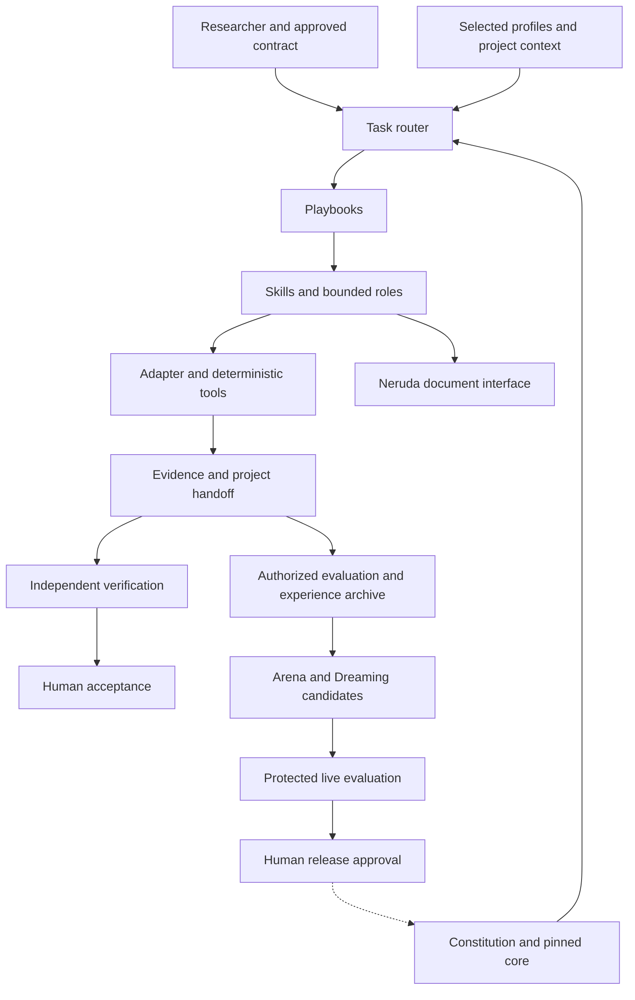
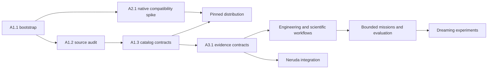

# ANDES architecture

**Status:** approved conceptual boundaries, implementation design pending discovery. Reference [ADR-001](docs/decisions/ADR-001.md) and [design baseline](docs/design-baseline.md). The pre-bootstrap repository contains only README and LICENSE; components below are planned responsibilities, not implemented services.

## System boundary

ANDES owns workflow definitions and explicit contracts, not the user's research code, data, external accounts or native chat history. Codex is the first runtime adapter. Neruda owns standalone typesetting and document infrastructure. GitHub is the initial source and task coordination system; source revisions and observed execution remain authoritative for actual behavior. ECx and other upstreams are reference sources only until specific reuse is reviewed. AEGIS informs public scientific values without requiring a persona or copying private context.

## Component responsibilities and interfaces

| Boundary | Responsibility | Planned dependencies / evidence |
|---|---|---|
| Constitution | Mandatory norms, proportional rigour and human authority | Reviewed policy; [CONSTITUTION.md](CONSTITUTION.md) |
| Principles and skills | Judgment heuristics and focused procedures with clear triggers/outputs | Reviewed provenance, dependency and validation metadata |
| Playbooks and roles | Compose skills and bounded responsibilities; select serial, parallel, competitive or review topology | Task contract and worker permission; no permanent swarm |
| Profiles/catalog | Canonical IDs, compatible dependency selections, source and release status | A1.3 schema and fixtures; no duplicate canonical instructions |
| Task router | Progressive selection; direct invocation when appropriate | Tested discovery and smallest relevant context |
| Distribution and adapter | Version resolution, release pinning, native discovery and installation, doctor and rollback | A2.1 real isolated probes, then packaging ADR and temporary-home tests |
| Context and evidence | Project orientation, task/handoff schemas, source references, receipt freshness | A3.1 validated contracts; project-owned data |
| Scientific profiles | Domain methods, numerical checks, ML splits, standards, scientific criticism, HPC | Profile-specific tests and approvals; no false biological claims |
| Mission runtime | Enforced scope, leases/checkpoints, budgets, ownership, cancellation, recovery and stop conditions | G5 fault tests; native runtime first, add smallest missing mechanism |
| Evaluation | Frozen fixtures, graders, comparisons, independent review, release gates | Protected trust domain, G6; manual reviewed evaluations before automation |
| Dreaming | Replay known outcomes in authorized exploration history; evaluate candidate policies | Coverage and unknown branches, live held-out transfer, G7 |
| Neruda integration | Authoring/review skills consume project evidence; call independently versioned document toolchain | Shared versioned evidence references, A3.1/N2.1; no runtime coupling |

There is no frontend/back-end server split at bootstrap. The user interface is the native agent, CLI/adapter if proven necessary, repository files and GitHub. Canonical workflow definitions must remain independent of runtime-specific configuration. Keep deterministic checks separate from language-model judgment and enforcement. Do not implement a central state service or database without measured need and an ADR.

## Data and authority model

Illustrative logical entities (not finalized schemas): `Release`, `Component`, `Profile`, `ProjectContext`, `TaskContract`, `EvidenceReceipt`, `Handoff`, `DecisionRecord`, `Mission`, `Attempt`, `EvaluationProtocol`, `Candidate`, `ExperienceNode` and `ObservedTransition`. Each entity with durable identity must be versioned or linked to immutable source/revision and scoped to its owner. A3.1 and later contracts establish exact fields, migrations, persistence and validation. Examples of `andes.yaml`, lockfile and `.andes/` are design proposals, not supported APIs.

| Record | Authoritative owner |
|---|---|
| Approved design, requirements and ADR | Designated human maintainer / project lead |
| Runtime code and observed behavior | Exact code revision and executed artifacts |
| Task status, dependencies and PRs | Designated tracker (GitHub initially) |
| Experiments, data and results | Research project and approved protocol/evidence store |
| Candidate and evaluation records | Authorized evaluator and release maintainer |
| Credentials, private learning and session history | Individual or restricted store; not public repository |

Conflicts between intended and observed behavior are explicit findings. Generated prose, third-party docs, data and tool outputs do not confer execution authority. Restrict context retrieval to relevant sources and permission boundaries. Progressive disclosure and deterministic indexing come first; advanced retrieval requires evidence of need.

## Key flows

### Orientation, work and review

1. Read applicable agent instructions and pinned release; identify project, revision, dirty state and scope. Recover task and handoff from authorized records; verify freshness.
2. Recommend rigour and mode, establish proportional contract and protected criteria. Select profiles and smallest appropriate workflow. Escalate consequential ambiguity to human decision.
3. Assign bounded work with independent slices or one writer for overlapping scope. Implement behavior-first; preserve evidence and failures. Domain reviews may use mathematical reference, units, convergence, leakage or interoperability checks.
4. Verify exact candidate and report independent quality dimensions; do not confuse implementation, tests, empirical validation or learning. Human accepts consequential decisions and deliverables.
5. Handoff next executable step, revision, ownership, permissions, evidence and limitations. Update durable verified facts only within scope.

### Long-running missions

Separate immutable authorized mission contract (objective, success, scope, permissions, budgets, protected invariants, checkpoint/escalation/termination/recovery) from mutable execution state. Each worker shares the parent's enforced resource/permission ceiling. Isolated Git worktrees avoid write conflicts but do not isolate credentials, network or shared databases. Stop safely on missing enforcement, failed protected check, exhaustion, cancellation or unresolvable block. Distinguish `ReviewReady`, `Blocked`, `BudgetExhausted` and human `Accepted`; restart must revalidate artifact/environment identity and authorization. Idempotent recovery and actual resource accounting require fault-injection evidence before unattended execution. Remote HPC remains subject to site policy: develop/review scripts locally; human performs remote commands as required by official rules. No persistent unattended cluster agent by default.

### Evaluation and evolution

Manual evaluations begin with basic fixtures. Keep candidate execution away from evaluator-only checks, protected held-out inputs and credentials. Freeze rubrics, comparison settings, budgets and candidate identities; record all eligible attempts and negative outcomes. Arena generates alternatives in independent workspaces and evaluates the synthesis again. Dreaming uses observed historical transitions only, records unknown branches and replay coverage; fresh controlled held-out runs are required to establish transfer or evaluate new skill instructions. No candidate can change its own grader, budget, permissions, constitution or promotion authority. Stable releases require explicit human approval of reviewed immutable identity.

## Deployment and operations

Local-first development, pinned releases and compatibility records. Target supported platforms are not determined; A2.1 investigates native Codex capabilities on isolated test homes. Preserve personal skills, configuration, credentials and native histories. No automatic environment changes; use non-destructive installation and ownership-aware rollback. Containers may support reproducible CI and later isolation after design review; no mandatory Docker Compose configuration, language, database, service or deployment stack is selected. Verify actual controls, not instructions or worktrees alone.

Operational evidence: record revisions, command/method, input identity, environment, result, timestamp and artifacts; separate agent-active elapsed time from waiting, and instrument resource usage without parent/child double counting. Protect private records and avoid secret/log exposure. Schema checks, deterministic unit tests, integration/behavioral tests, domain tests and security/fault-injection tests must be introduced alongside the corresponding feature. Actual command names and supported checks are documented when implemented. Public synthetic fixtures and restricted graders are separate.

## Delivery and decision frontiers

The actual task dependencies are in the approved Implementation Plan v0.1. This is a dependency sketch, not a replacement for the backlog. A1.4 establishes CI and governance mechanisms after catalog contracts. A1.2 audits ECx, ECC, pstack, Matt Pocock skills, official BriCS guidance and other planned sources before adaptation. Do not import unfinished ECx evaluator machinery or personal configuration.

Open decisions: A2.1 native discovery/roles/packaging, A1.3 catalog and composition, A3.1 schemas and evidence interoperability, later mission containment and protected evaluation/replay architecture, platform support, source licenses and university permissions. Record alternatives and actual observed evidence in ADRs. An unsupported capability stays disabled; no release gate may be bypassed. See [PRODUCT.md](PRODUCT.md) for staged user outcomes.
